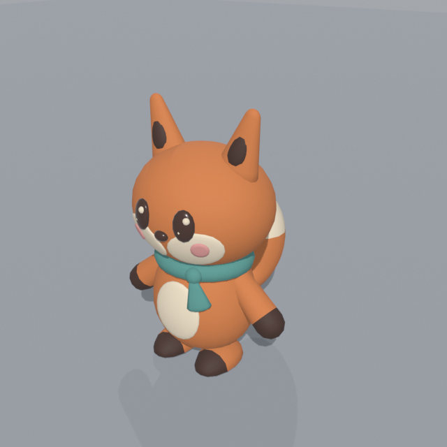
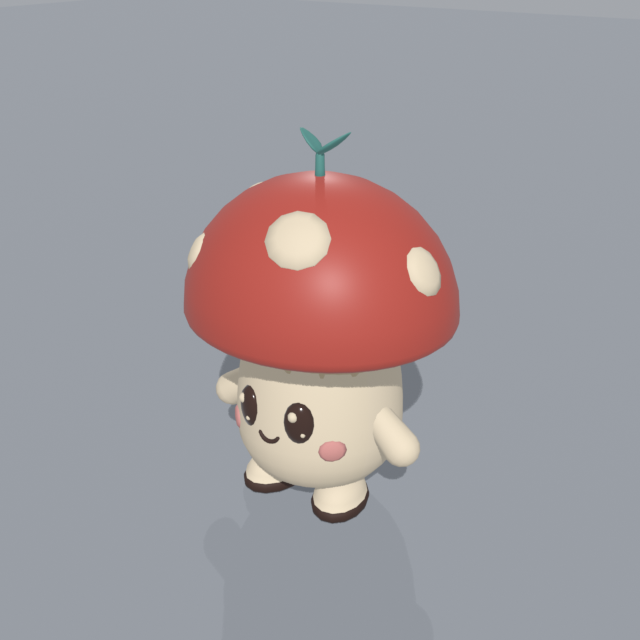
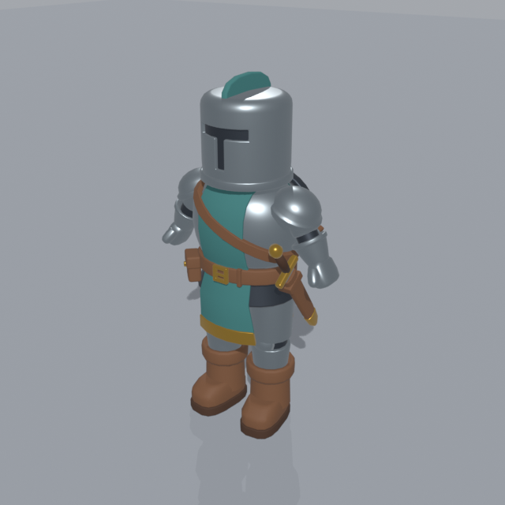
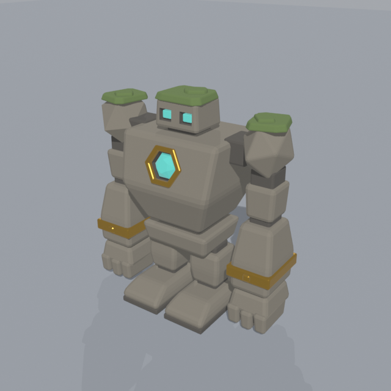

# Asset Forge

Describe a 3D asset in words and AI agents build it in Blender, review their own renders, and improve it until it is good. You get a GLB, an FBX and a Blender file for each asset.

## Built with it

These models were built from one-line requests ("a 3d game character", "create 3d cute characters for my game"), with Claude Fable 5.2 as the builder. The images are the app's own preview renders.

| | |
|---|---|
|  |  |
| Round Fox Cub | Mushroom Sprite |
|  |  |
| Wandering Knight Hero | Stone Golem Companion |

## What you need

- **Blender**: https://www.blender.org/download/ (tested on 5.3 only; 4.2 and newer should work)
- **Node.js** 20 or newer: https://nodejs.org
- **An Anthropic API key**: https://console.anthropic.com → API Keys

## Start

Double-click `start.bat`. The first start installs one dependency, then the app opens in your browser at http://localhost:4780.

Open **Settings**, paste your API key, pick a model and save. Blender is found automatically if it is installed in the usual place.

On macOS or Linux run `npm install` once and then `npm start`.

## How it works

1. **Director** turns your request into a brief per asset: size, key features, colour palette, polygon budget.
2. **Modeller** writes a Blender Python script for each asset.
3. **Blender** runs the script in the background, exports the files and renders four views.
4. **Critic** looks at the renders, scores them out of 10 and lists what to fix.
5. The modeller gets the renders and the review and tries again, until the score reaches your threshold or the round limit. The best attempt is kept.
6. **Lessons**: after each asset the modeller writes down what would have saved it a round. Those lessons are given to every later run, so it makes fewer of the same mistakes. You can read, switch off, delete or add lessons on the Lessons page.

Several assets are built in parallel. Finished files are in `output/<job>/<asset>/`. Lessons are kept in `data/lessons.json`. Both folders stay on your computer and are not part of the repository.

## Cost

Every build spends API credits. The job page shows an estimate of tokens and dollars as it runs. Cost depends mostly on the model and on the number of review rounds; both are in Settings.

A spending cap per job (default $5, in Settings) stops a job once its estimated cost passes the cap and keeps the assets that are finished. As a reference point, two characters with Claude Fable 5.2 and four review rounds each cost about $15 before conversation caching was added; Claude Sonnet 5.5 as builder with Claude Haiku 5.5 as critic is far cheaper.

## What it is good and bad at

Good: constructed objects such as props, furniture, buildings, vehicles and tools, in low-poly or stylised looks, with flat-colour materials.

Bad: characters, animals and other organic shapes, and anything that needs painted textures.

## Safety

- The API key is saved in `%APPDATA%\AssetForge\settings.json`, outside this folder, and is sent only to Anthropic.
- The app listens only on your own computer (127.0.0.1).
- Generated scripts are checked before they run: only modelling imports are allowed and file access, saving, exporting and Blender's system operators are blocked. This is a guard against mistakes, not a full sandbox.

## Offline test

`node server.js --fake` runs the whole pipeline with a scripted stand-in for the model, so you can check Blender and the UI without a key or any cost. It writes to `.test/` and leaves real settings, lessons and output alone.
